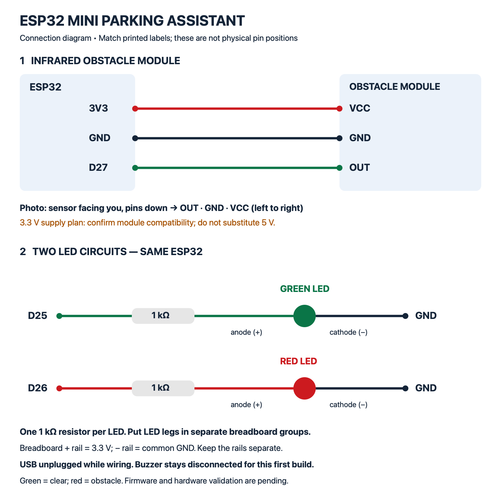

# ESP32 Mini Parking Assistant

A simple brownbag project: detect a nearby object and switch between a green and a red LED.

- **No obstacle detected:** green LED on, red LED off.
- **Obstacle detected:** red LED on, green LED off.

The infrared obstacle avoidance module provides a digital detection signal. This project does not measure distance in centimeters. Detection depends on the object's reflectivity, lighting, and module adjustment.

## First build

Use an ESP32, an obstacle avoidance module, two LEDs, and two 1 kΩ resistors. Power the assembled project over USB after checking the wiring and module compatibility.

The active buzzer is an optional later addition, pending its voltage/current specification and driver requirements. The first build uses visual feedback only.

## Documentation

1. [Electronics list](docs/hardware/electronics-list.md)
2. [Visual wiring diagram](docs/hardware/wiring-diagram.md)
3. [Wiring instructions](docs/hardware/wiring.md)
4. [Software setup](docs/setup/getting-started.md)
5. [Brownbag session guide](docs/workshop/session-guide.md)

## Status

Documentation and proposed wiring are ready. The photo confirms the obstacle module's OUT/GND/VCC labels. Its 3.3 V compatibility and detection polarity still need confirmation from the actual module or its documentation. Firmware and physical testing are pending.

This project replaces the earlier Desk Buddy idea. We are reusing the existing [GitHub repository](https://github.com/ArgeeGabrielII/ESP32-Smart-Desk-Buddy); its repository name has not changed.
