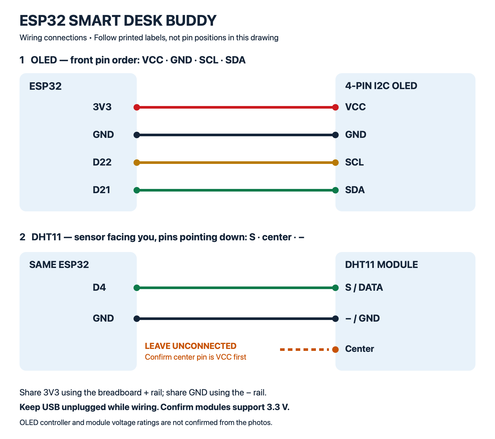
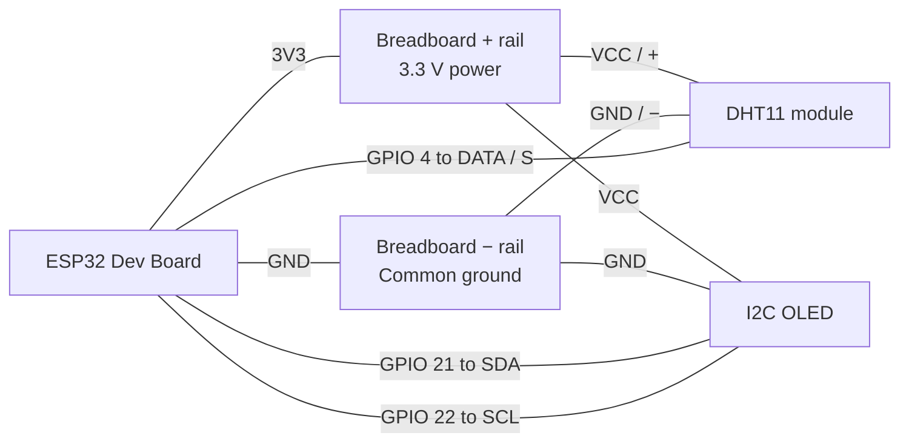

# Wiring diagram

The image reflects the pin labels visible in the supplied photos. The DHT11 center pin is left unconnected until its power label is confirmed. Module voltage ratings and the OLED controller still need confirmation. The complete plan below includes the DHT power connection only after those checks.

This diagram shows electrical connections, not the physical position or order of pins. Match the printed pin labels on your modules.

**Unplug USB before wiring.** This plan assumes a classic ESP32 with GPIO 4, 21, and 22, a four-pin I2C OLED, and a three-pin DHT11 module. Confirm both modules support 3.3 V power. See the [hardware guide](wiring.md) for module checks and pull-up resistor details.

## How to follow the diagram

1. Connect ESP32 **3V3** to the breadboard's **+ rail**.
2. Connect ESP32 **GND** to the breadboard's **− rail**.
3. Connect both modules' power pins to the + rail and ground pins to the − rail.
4. Connect DHT11 **DATA** to **GPIO 4**.
5. Connect OLED **SDA** to **GPIO 21**, and **SCL** to **GPIO 22**.

Use one continuous section of each breadboard rail. The two rails must remain separate; the rail marked + carries 3.3 V in this build. Do not connect it to VIN or 5V.

The diagram does not show a DHT data pull-up: breakout modules often include one. If yours does not, follow its specifications and the [hardware guide](wiring.md) before powering on.

Check the finished wiring against the [connection table](wiring.md#connect-the-first-build). The circuit still needs validation on the actual parts. The OLED requires firmware to show the dashboard.
